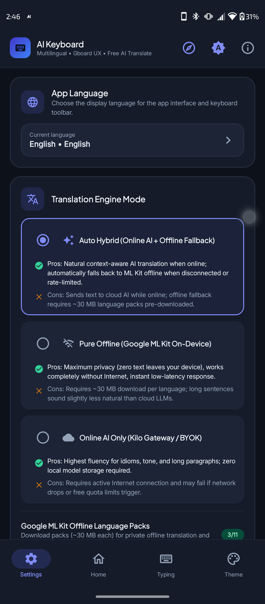
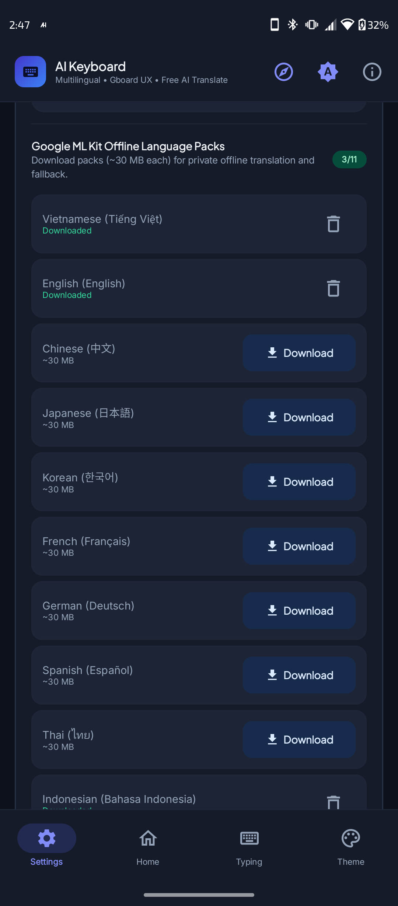
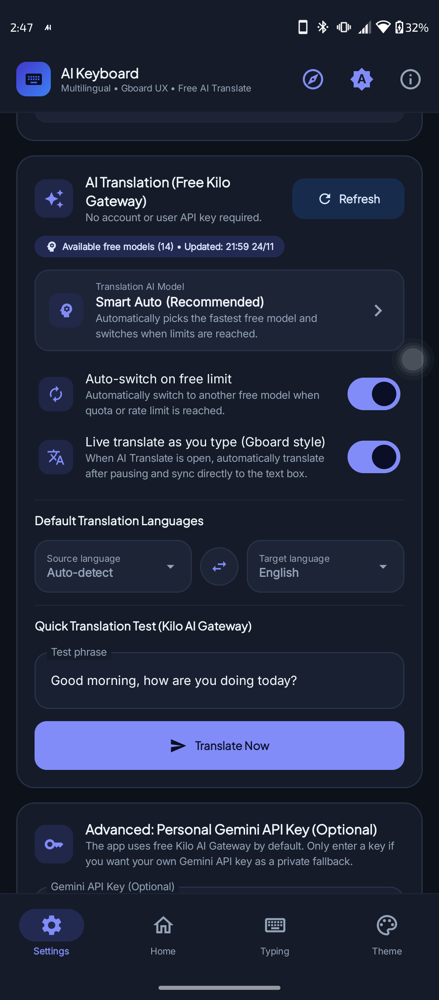
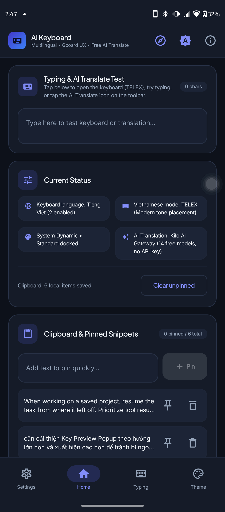
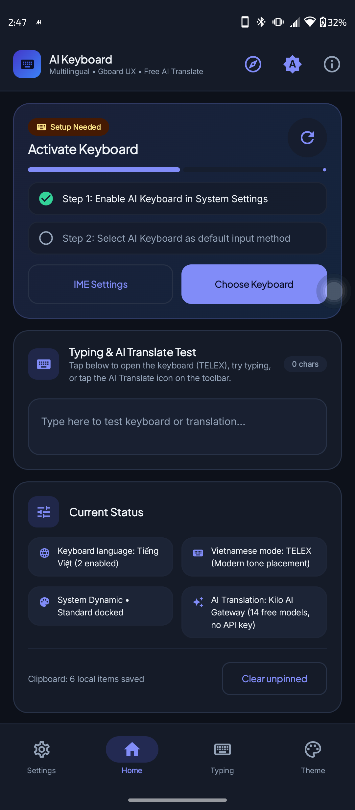
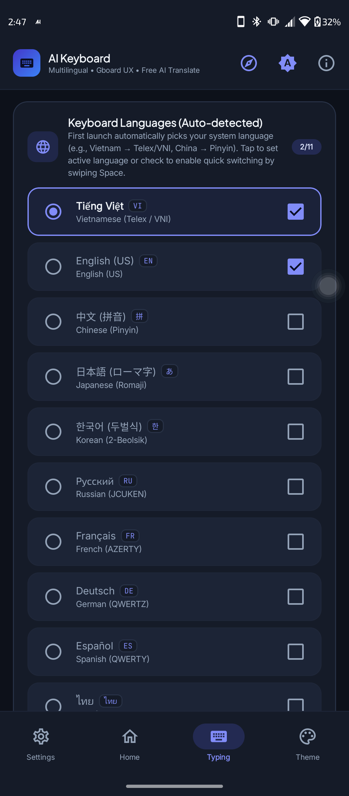
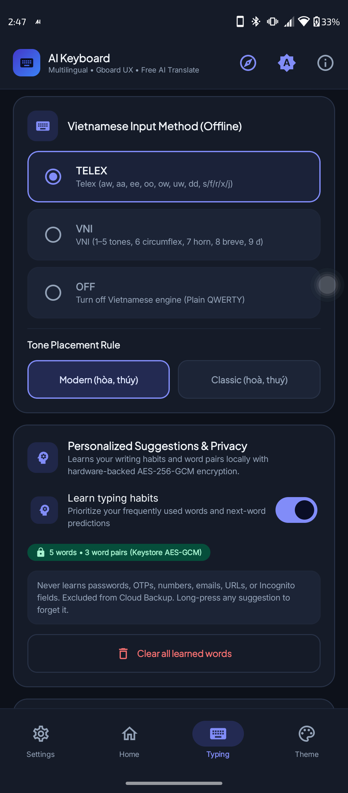
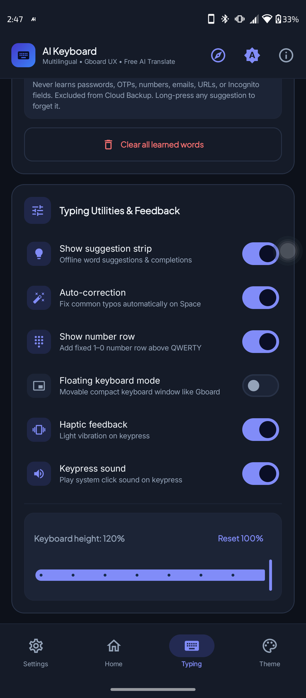
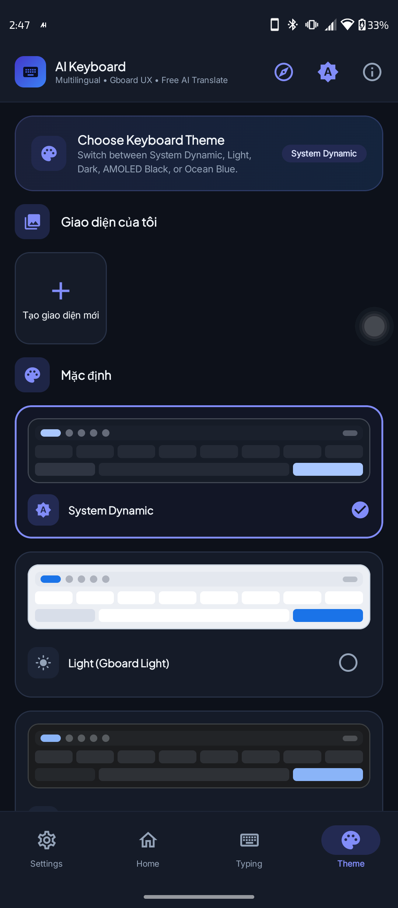
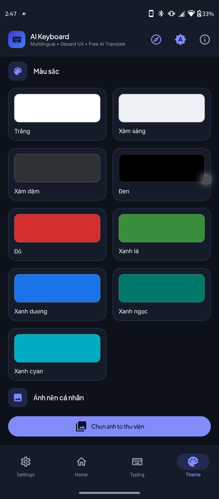

# AI Keyboard

Multilingual Gboard-style Android keyboard with offline Vietnamese Telex/VNI input, Pinyin, Hangul, Romaji, floating keyboard mode, and keyless free AI translation powered by Kilo AI Gateway and Google ML Kit.

## About

AI Keyboard is a full-featured Android input method editor (IME) designed for comfortable multilingual typing. It combines offline language engines (Vietnamese Telex/VNI, Chinese Pinyin, Japanese Romaji, Korean Hangul, Russian, French, German, Spanish, Indonesian, Thai) with optional AI translation, encrypted personal dictionary storage, and theme customization.

The app consists of two Gradle modules:
- **`app`** — Companion settings UI, theme studio, onboarding, AI translation orchestration, clipboard, and encrypted personal lexicon.
- **`core-vietnamese-ime`** — Core multilingual IME engine with Vietnamese, Chinese, Japanese, Korean, and other language input methods.

## Key Features

All features below are implemented and verified in the source code:

### Typing & Input Methods
- Offline Vietnamese Telex and VNI input with modern and classic tone placement
- Chinese Pinyin input engine
- Japanese Romaji input engine
- Korean Hangul (2-Beolsik) input
- Russian, French, German, Spanish, Indonesian, and Thai QWERTY layouts
- Floating keyboard mode (movable compact window)
- Adjustable keyboard height
- Number row, haptic feedback, keypress sound
- Auto-correction and word suggestions
- Clipboard history with local storage

### AI Translation
- Keyless free translation via Kilo AI Gateway (no API key or account required)
- Google ML Kit on-device translation for 100% offline privacy
- Auto Hybrid mode: online AI with automatic offline fallback
- Live translate-as-you-type (Gboard style)
- Quick translation test panel
- Optional personal Gemini API key (BYOK) as a private fallback
- Free model catalog with auto-switching on rate limits and cooldown tracking

### Personalization
- Theme presets: System Dynamic, Light, Dark, AMOLED Black, Ocean Blue
- Custom color themes with 9 background color swatches
- Personal photo background from device gallery with opacity slider
- Theme preview and apply flow
- Light, Dark, and AMOLED appearance modes

### Privacy & Security
- Personal dictionary encrypted with AES-256-GCM via Android Keystore
- HMAC-SHA256 deterministic lookup keys (plaintext never stored in SQLite)
- Zero cloud upload of typing habits
- Learning paused on passwords, incognito fields, and OTPs
- Hold-to-forget suggestions
- Long-press any suggestion to remove it from learning

### Onboarding & Discovery
- 3-slide interactive walkthrough on first launch
- Spotlight coach-marks for core companion features
- DataStore persistence for onboarding completion
- Feature discovery hub with progress tracking

## Architecture and Project Structure

The project follows a modular Android Gradle structure with Jetpack Compose for the companion UI and a traditional `InputMethodService` for the keyboard IME.

```
AIKeyboard/
├── app/
│   ├── build.gradle.kts                  # App module Gradle config
│   ├── proguard-rules.pro
│   └── src/
│       ├── main/
│       │   ├── AndroidManifest.xml
│       │   ├── java/com/ai/banphim/
│       │   │   ├── MainActivity.kt
│       │   │   ├── ai/                     # AI translation providers & orchestration
│       │   │   ├── data/                   # Room DB, DataStore, repositories, crypto
│       │   │   ├── ime/                    # IME service, keyboard view, suggestion engine
│       │   │   └── ui/                     # Compose screens, theme, settings
│       │   └── res/
│       │       ├── values*/strings.xml     # 12 languages (en, vi, id, zh, ja, ko, fr, de, es, th, ru, in)
│       │       ├── drawable/, font/, mipmap-*/
│       │       └── xml/                    # method.xml, locales_config.xml, backup rules
│       ├── test/                           # Unit tests
│       └── androidTest/                    # Instrumented tests
├── core-vietnamese-ime/
│   ├── build.gradle.kts
│   ├── proguard-rules.pro
│   └── src/
│       ├── main/
│       │   └── java/com/ai/banphim/ime/engine/   # Vietnamese, Pinyin, Romaji, Hangul engines
│       └── test/
├── gradle/
│   └── wrapper/                            # Gradle Wrapper (gradlew, gradlew.bat, properties, jar)
├── public/
│   └── assets/                             # Project screenshots
├── build.gradle.kts                        # Root build config
├── settings.gradle.kts                     # Module declarations
├── gradle.properties                       # Gradle JVM & cache settings
├── gradle/libs.versions.toml               # Dependency version catalog
├── .gitignore                              # Git ignore rules
├── debug.keystore                          # Debug signing keystore (not for release)
├── release-key.jks                         # Release signing keystore (do not commit)
├── metadata.json                           # Project metadata
├── CHANGELOG.md                            # Release history
└── README.md
```

### Key Packages
- `com.ai.banphim.ai` — Translation providers (Kilo Gateway, Gemini BYOK), model catalog, free limit tracking
- `com.ai.banphim.data` — Room databases, DataStore preferences, repositories, AES/HMAC cryptography
- `com.ai.banphim.ime` — InputMethodService, keyboard canvas, layout, translation buffer
- `com.ai.banphim.ime.engine` — Language engines: Vietnamese Telex/VNI, Pinyin, Romaji, Hangul
- `com.ai.banphim.ime.suggestion` — Word suggestion engine with trie and sensitive-token filtering
- `com.ai.banphim.ui` — Compose settings screens, theme studio, onboarding, about

## Technologies Used

| Category | Technology |
|----------|------------|
| Language | Kotlin, Java |
| UI Framework | Jetpack Compose, Material 3 |
| IME Framework | Android InputMethodService |
| Database | Room (SQLite) |
| Preferences | DataStore Preferences |
| Cryptography | Android Keystore, AES-256-GCM, HMAC-SHA256 |
| Translation | Kilo AI Gateway, Google ML Kit On-Device Translation, Language ID |
| Networking | OkHttp, Logging Interceptor |
| JSON | Moshi |
| Coroutines | kotlinx.coroutines |
| Testing | JUnit 4, Robolectric, Espresso, Compose Test |
| Build | Gradle, Android Gradle Plugin 9.1.1, Kotlin 2.4.21, KSP |

## Requirements

- **Android Studio** (latest stable, Hedgehog or newer recommended)
- **JDK 17**
- **Gradle** 9.3.1 (via Gradle Wrapper, included)
- **Android SDK**
  - Compile SDK: 36
  - Target SDK: 36
  - Minimum SDK: 24 (Android 7.0 Nougat)

No Firebase, Google Play Services, or external API key is required for core functionality. The optional Gemini BYOK feature requires the user to supply their own API key manually in Settings.

## Installation and Running

1. **Clone the repository**
   ```bash
   git clone https://github.com/<your-username>/AIKeyboard.git
   cd AIKeyboard
   ```

2. **Open in Android Studio**
   - Launch Android Studio
   - Select **Open** and choose the cloned `AIKeyboard` folder
   - Allow Android Studio to sync the project with Gradle

3. **Sync Gradle**
   - Wait for the Gradle sync to complete
   - The project uses the Gradle Wrapper (`gradlew`), no manual Gradle installation required

4. **Build APK**
   - From Android Studio: **Build > Build Bundle(s) / APK(s) > Build APK(s)**
   - Or via command line:
     ```bash
     ./gradlew assembleDebug
     ```

5. **Run on device or emulator**
   - Connect a physical device with USB debugging enabled, or launch an Emulator
   - From Android Studio: **Run > Run 'app'**
   - Or via command line:
     ```bash
     ./gradlew installDebug
     ```

6. **Enable the keyboard**
   - Open the app from the launcher
   - Follow **Setup > Activate Keyboard** to enable AI Keyboard in system settings
   - Select AI Keyboard as the default input method

### Signing Configuration

The project includes a `debug.keystore` for debug builds. The `release-key.jks` is present locally but its passwords are intentionally parameterized via Gradle properties (`RELEASE_STORE_PASSWORD`, `RELEASE_KEY_ALIAS`, `RELEASE_KEY_PASSWORD`). For release builds, define these in your `gradle.properties` or CI environment; do not commit keystore files or passwords.

## Screenshots

<table>
  <tr>
    <td></td>
    <td></td>
    <td></td>
  </tr>
  <tr>
    <td></td>
    <td></td>
    <td></td>
  </tr>
  <tr>
    <td></td>
    <td></td>
    <td></td>
  </tr>
  <tr>
    <td></td>
  </tr>
</table>

Tất cả ảnh chụp màn hình được lưu trong thư mục `Screenshot/` của repository.

## License

This project is provided as-is for personal and educational use. See repository settings for license details.
